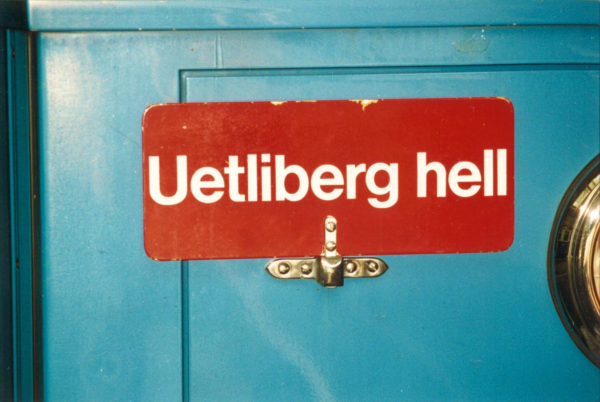

# Üetliberg Hell!

Digital-era "Üetliberg Hell" detection. When Zurich sinks into fog, Üetliberg breaks through the grey. This app is guiding you to clear skies, light, and warmth above the city.

> Was Fry jedoch vermisse, sei der Hinweis «Uetliberg hell» an den Trams in der Stadt. Die Tafel war früher an den Fahrzeugen der Linien 8, 13 und 14 angebracht, um die Stadtbevölkerung zu informieren, dass die Spitze des Stadtberges aus dem Nebel rage. 
> [Uto-Kulm-Wirt wünscht sich dieses Schild auf den Trams zurück](https://www.20min.ch/story/uto-kulm-fabian-fry-fordert-rueckkehr-des-uetliberg-hell-schilds-103214839)

